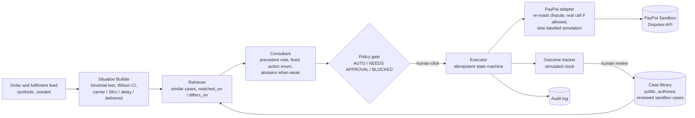

# Precedent

An operations consultant for PayPal merchants that cites past cases before it acts.

It detects a dispute spike, retrieves similar past cases, explains why they match and
where they differ, proposes typed actions, and only after a deterministic policy gate
and a human click, executes them through the PayPal Sandbox. The same symptom
(an item-not-received spike) leads to three different plans depending on the signals.

Built for the PayPal AI Hackathon. **Work in progress.**

## How it works



Results so far: the held-out test is in [eval/results/test/summary.md](eval/results/test/summary.md);
the development set is in [eval/results/summary.md](eval/results/summary.md); the run log is in
[eval/README.md](eval/README.md). Submission draft:
[docs/SUBMISSION.md](docs/SUBMISSION.md). Demo script: [docs/DEMO_SCRIPT.md](docs/DEMO_SCRIPT.md).

## Honest labels

- The demo merchant's order feed is **synthetic**. Detection statistics run on it for real.
- The case library is currently **authored** playbook cases, labelled `illustrative`.
  None of them carries outcome numbers, so the app shows **no numeric forecast**.
  Numeric effects are only ever computed from `measured_observational` cases.
- PayPal: token, dispute reads and seller actions are **real sandbox calls**. A real seller
  message was sent on our sandbox dispute. The adapter re-reads the dispute before every
  action. If PayPal does not allow that action at that moment, or no real dispute is linked
  (the synthetic situations B and C), execution is **simulated** and labelled. See
  [docs/SPIKE1_RESULT.md](docs/SPIKE1_RESULT.md).
- An optional AI writer (`PRECEDENT_LLM_WRITER=1` plus Anthropic credentials, model
  `claude-opus-5-5`) may only reword the explanations. It cannot change actions, amounts or
  citations. Its text is rejected if it adds a number that is not in the data, or uses
  causal words.
- The outcome clock is **simulated**. Its results become `live_simulated` cases pending
  review, which never drive a forecast.
- Outcomes are "observed" or "followed", never "caused". Not financial advice.

## Layout

| Path | What |
|---|---|
| `contracts/` | JSON schemas, shared thresholds, fixtures (the contract between frontend and backend) |
| `cases/` | Case library (authored now; public cases next) |
| `intelligence/` | Consultant, baseline retriever, effects rule, reference policy gate, stats |
| `scripts/build_fixtures.py` | Builds and validates the demo fixtures from the pipeline |
| `frontend/` | React + Vite dashboard (runs on fixtures, or a real API via `VITE_API_BASE`) |
| `backend/precedent/` | API (FastAPI), executor, PayPal adapter, order-feed generator, Situation Builder, outcome tracker, SQLite store |
| `backend/spike1/` | PayPal sandbox spike scripts (credentials in `backend/.env`, never committed) |
| `eval/` | Ablation runner, rubric, blind score sheet, results |
| `data/reference/` | Platform-wide public figures (context, not precedents) |
| `docs/` | Brief, design, handoffs, spike results |

## Run

**Tests and fixtures**

```bash
pip install jsonschema pytest fastapi uvicorn httpx
python scripts/build_fixtures.py
python -m pytest -q
```

**Dashboard on fixtures (no backend):**

```bash
cd frontend && npm install && npm run dev
```

Then open http://localhost:5173.

**Full app (backend + dashboard in API mode):**
1. Put sandbox credentials in `backend/.env` (see `backend/.env.example`).
2. Start the API:
   ```bash
   python -m uvicorn precedent.api:app --app-dir backend --port 8000
   ```
3. Start the dashboard in API mode:
   ```bash
   cd frontend && npm run dev:api
   ```
4. Open http://localhost:5174. API docs are at http://localhost:8000/docs.
5. To run the demo again: `POST /api/demo/reset`. This clears approvals and outcomes, not
   PayPal.

**Ablation:** `python eval/run_ablation.py` (see `eval/README.md`).

**Deploy (one container, API and dashboard on one URL):**

```bash
docker build -t precedent .
docker run -p 8000:8000 --env-file backend/.env precedent
```

Any host that runs a Dockerfile works (for example Render or Fly.io). Set the PayPal
variables from `backend/.env.example` as secrets in the host's settings; never bake them
into the image. Not yet built here (Docker is not installed on the dev machine). The
same-origin setup was checked locally by serving the built dashboard from the API.

On Windows Git Bash, prefix local builds that set `VITE_API_BASE=/` with
`MSYS_NO_PATHCONV=1`. Otherwise Bash rewrites `/` into a Windows path.

## Licence

MIT, see [LICENSE](LICENSE).
