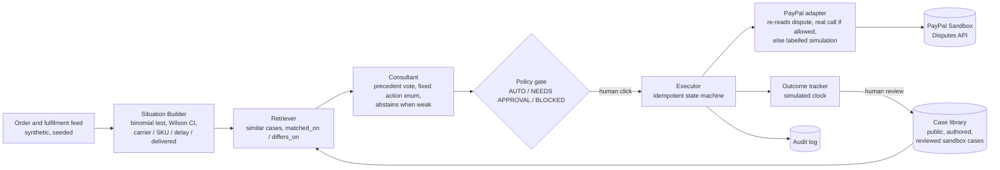

# Precedent

An operations consultant for PayPal merchants that cites past cases before it acts.

It detects a dispute spike, retrieves similar past cases, explains why they match and
where they differ, proposes typed actions, and only after a deterministic policy gate
and a human click, executes them through the PayPal Sandbox. The same symptom
(an item-not-received spike) leads to three different plans depending on the signals.

Built for the PayPal AI Hackathon. **Work in progress.**

## How it works



Results so far: the held-out test is in [eval/results/test/summary.md](eval/results/test/summary.md);
the development set is in [eval/results/summary.md](eval/results/summary.md); the run log is in
[eval/README.md](eval/README.md). Submission draft:
[docs/SUBMISSION.md](docs/SUBMISSION.md). Demo script: [docs/DEMO_SCRIPT.md](docs/DEMO_SCRIPT.md).

## Honest labels

- The demo merchant's order feed is **synthetic**. Detection statistics run on it for real.
- The case library is currently **authored** playbook cases, labelled `illustrative`.
  None of them carries outcome numbers, so the app shows **no numeric forecast**.
  Numeric effects are only ever computed from `measured_observational` cases.
- PayPal: token, dispute reads and seller actions are **real sandbox calls**. A real seller
  message was sent on our sandbox dispute. The adapter re-reads the dispute before every
  action. If PayPal does not allow that action at that moment, or no real dispute is linked
  (the synthetic situations B and C), execution is **simulated** and labelled. See
  [docs/SPIKE1_RESULT.md](docs/SPIKE1_RESULT.md).
- An optional AI writer (`PRECEDENT_LLM_WRITER=1` plus Anthropic credentials, model
  `claude-opus-5-5`) may only reword the explanations. It cannot change actions, amounts or
  citations. Its text is rejected if it adds a number that is not in the data, or uses
  causal words.
- The outcome clock is **simulated**. Its results become `live_simulated` cases pending
  review, which never drive a forecast.
- Outcomes are "observed" or "followed", never "caused". Not financial advice.

## Layout

| Path | What |
|---|---|
| `contracts/` | JSON schemas, shared thresholds, fixtures (the contract between frontend and backend) |
| `cases/` | Case library (authored now; public cases next) |
| `intelligence/` | Consultant, hybrid and baseline retrievers, effects rule, reference policy gate, stats |
| `scripts/build_fixtures.py` | Builds and validates the demo fixtures from the pipeline |
| `frontend/` | React + Vite dashboard (runs on fixtures, or a real API via `VITE_API_BASE`) |
| `backend/precedent/` | API (FastAPI), executor, PayPal adapter, order-feed generator, Situation Builder, outcome tracker, SQLite store |
| `backend/spike1/` | PayPal sandbox spike scripts (credentials in `backend/.env`, never committed) |
| `eval/` | Ablation runner, rubric, blind score sheet, results |
| `data/reference/` | Platform-wide public figures (context, not precedents) |
| `docs/` | Brief, design, handoffs, spike results |

## Run

**Tests and fixtures**

```bash
pip install -r requirements.txt
python scripts/build_fixtures.py
python -m pytest -q
```

**Dashboard on fixtures (no backend):**

```bash
cd frontend && npm install && npm run dev
```

Then open http://localhost:5173.

**Full app (backend + dashboard in API mode):**
1. Put sandbox credentials in `backend/.env` (see `backend/.env.example`).
2. Start the API:
   ```bash
   python -m uvicorn precedent.api:app --app-dir backend --port 8000
   ```
3. Start the dashboard in API mode:
   ```bash
   cd frontend && npm run dev:api
   ```
4. Open http://localhost:5174. API docs are at http://localhost:8000/docs.
5. To run the demo again: `POST /api/demo/reset`. This clears approvals and outcomes, not
   PayPal.

**Isolated local demo (PowerShell, no credentials):**

```powershell
cd frontend
$env:VITE_API_BASE="/"
npm.cmd run build
cd ..
.\.venv\Scripts\python.exe scripts/run_local_demo.py
```

Open http://127.0.0.1:8765. This runner uses an in-memory database, the default
hybrid retriever, and no PayPal or LLM credentials. All external actions simulate;
its case reviews and outcomes disappear when the process stops. It doesn't change
the normal app's database. Use `--port 8766` if the default port is occupied.

Choose **D: overlapping signals (review needed)** to check abstention: the plan
explains the uncertainty, offers no action, and skips approval, execution and the
outcome clock in both precedent modes. A/B/C still demonstrate the three original
remedies. D reuses the known mixed development case; it is not a new evaluation set.

**PayPal in and out:** Precedent imports the sandbox account's disputes (Disputes API) and
each parcel's state (Add Tracking API). It triages them with the same dispute-level cases,
and sends approved seller actions back to that exact dispute. The dashboard's **PayPal**
section shows the account live, plus a log of every PayPal request. Details:
[docs/PAYPAL_INTEGRATION.md](docs/PAYPAL_INTEGRATION.md). Locally, read-only:
`python scripts/run_local_demo.py --paypal`.

**TechKart test environment (dispute-level triage):** situation **T** is the spec's
delivery-failure merchant. Each open not-received dispute is matched to dispute-level
cases by its parcel's real state (delivered, in transit, lost, no tracking) and its
response deadline, then grouped into gated actions. "Without precedent" shows the spec's
generic consultant. Details: [docs/TECHKART_TEST_ENV.md](docs/TECHKART_TEST_ENV.md).
Evaluation: `python eval/run_techkart.py` (results in `eval/results/techkart/`). To run
real sandbox calls per state, set
`TECHKART_SANDBOX_DISPUTES=delivered:PP-...,in_transit:PP-...,lost:PP-...` in `backend/.env`.

**Ablation:** `python eval/run_ablation.py` (see `eval/README.md`).

**Retrieval integration:** API mode now defaults to structured similarity plus local
TF-IDF narrative ranking, fused with reciprocal ranks (90% structured, 10% text).
TF-IDF is lexical matching, not semantic embeddings. `similarity`, `matched_on`,
and `differs_on` retain their structured meaning; the 0.6 policy threshold is
unchanged. Eligible structured matches rank ahead of weak matches. A 2% ranking
boost applies only to public measured cases with before/after outcomes. Pending
and rejected cases are excluded. Numeric effects still use the existing measured-only rule.

Set `PRECEDENT_RETRIEVER=structured` in `backend/.env` to use the old retriever.
For semantic embeddings, install `requirements-embeddings.txt` alongside the base
requirements in a Python 3.12 environment, provision a SentenceTransformer model
locally (for example `sentence-transformers/all-MiniLM-L6-v2`), then set
`PRECEDENT_RETRIEVER=semantic` and `PRECEDENT_EMBEDDING_MODEL` to its local directory.
The model loads offline with remote code disabled; missing dependencies or weights
raise an error instead of silently changing retrieval modes. Restart the API after
changing retrieval settings. Semantic model quality has not yet been evaluated here.

`python eval/compare_retrieval.py` compares the baseline and default hybrid on known
development scenarios without changing previous evaluation artifacts. Add
`--semantic-model PATH` to evaluate a provisioned embedding model. The new text
weight was adjusted against the three demo scenarios; these are regression checks,
not new held-out results. Existing headline results describe the old structured
retriever. Fixture generation uses the default TF-IDF hybrid for reproducibility.

**Overlapping signals:** an optional `features.diagnostic_conflict` records an
exploratory comparison of not-received disputes without delivery scans among
orders dispatched within 48h, against the same cohort in the baseline. When the
overall spike is anomalous and median dispatch is at least 36h, the check requires
at least 100 current / 500 baseline promptly shipped orders, at least 3 current
losses, and one-sided Fisher exact p < 0.10. This is a conservative review trigger,
not proof of a carrier failure or multiple causes. It abstains in both modes and
never authorizes an action. Small or weak signals can remain undetected. See
[integration notes](docs/INTEGRATION_2026-11-08.md) for the development-only results.

**Webhooks:** the receiver now persists verified dispute history, deduplicates by
PayPal event ID across restarts, and keeps older updates from replacing newer
snapshots. View history at `/api/paypal/disputes/{dispute_id}/events` and receipt
records at `/api/audit`. Related actions are contextual links, not confirmation
of execution or resolution. See [webhook setup and tests](docs/WEBHOOKS.md).
Live sandbox delivery still needs a registered public HTTPS callback.

**Deploy (one container, API and dashboard on one URL):**

```bash
docker build -t precedent .
docker run -p 8000:8000 --env-file backend/.env precedent
```

**Public demo on Render (for judges):** [`render.yaml`](render.yaml) is a Render Blueprint.
In Render choose New, then Blueprint, and pick this repository (branch `main`). It builds the
Dockerfile as one always-on web service with a health check on `/api/health`. Render asks
for the PayPal **sandbox** app credentials (`PAYPAL_CLIENT_ID`, `PAYPAL_CLIENT_SECRET`):
- With them, the site reads the sandbox account live and triages its disputes. Approving
  "send message" or "provide evidence" on an imported dispute calls PayPal for real, capped
  at 20 real actions an hour. Refunds and offers stay simulated. See
  [docs/PAYPAL_INTEGRATION.md](docs/PAYPAL_INTEGRATION.md).
- Without them, everything still works, simulated and labelled.
- `PRECEDENT_PER_VISITOR=1`: each browser gets its own in-memory demo workspace, keyed by a
  random id the dashboard keeps in local storage. One judge's approvals, simulated clock and
  case reviews never appear for another. **Reset demo** in the top bar clears only your own
  workspace. Workspaces are dropped after 12 idle hours or past 500 visitors
  (`PRECEDENT_VISITOR_IDLE_HOURS`, `PRECEDENT_MAX_VISITORS`), and all of them on restart.

Any other host that runs a Dockerfile works too (for example Fly.io). For a private
deployment with real sandbox calls, set the PayPal variables from `backend/.env.example` as
secrets in the host's settings (never bake them into the image), and leave
`PRECEDENT_PER_VISITOR` unset. The image has not been built here (Docker is not installed on
the dev machine). Its exact file layout and environment were checked locally by running
uvicorn on a copy of only what the Dockerfile copies.

On Windows Git Bash, prefix local builds that set `VITE_API_BASE=/` with
`MSYS_NO_PATHCONV=1`. Otherwise Bash rewrites `/` into a Windows path.

## Licence

MIT, see [LICENSE](LICENSE).
