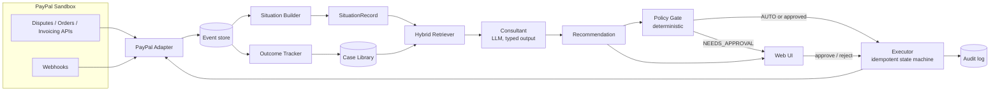
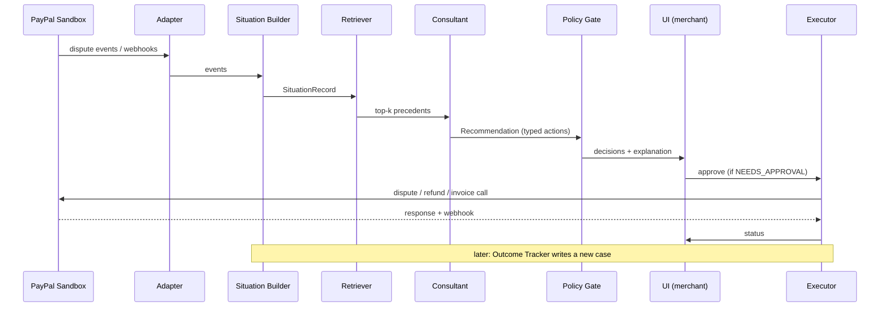

# MediateAI: design (working title)

An AI finance consultant for PayPal merchants. It recognises a risk or cash-flow
situation, retrieves analogous precedents from a case library, proposes a remedy,
executes it through PayPal behind a policy gate, then measures the outcome and
writes it back as a new case.

Status: draft v0.2, 2026-11-06 (adds evidence-quality rules, a merchant order
feed, the three-situation contrast and a trimmed eval plan). Hackathon deadline 12 Nov (confirm the exact
cutoff on the Devpost page).

## 0. Assumptions (change these and the design changes)

| # | Assumption | If wrong |
|---|---|---|
| A1 | Wedge is **merchant disputes and chargebacks** | Swap the situation features and action set; the pipeline stays the same |
| A2 | Two people, about 6 days | Cut the UI polish first, then the second scenario |
| A3 | Retrieval plus policy, **no fine-tuning** | Fine-tuning would be a roadmap slide only |
| A4 | USD, PayPal Sandbox only | INR support is doubtful; verify before using it |
| A5 | One demo merchant, two optional tenants if time allows | Multi-tenant is a stretch goal |
| A6 | Outcomes in the demo are **simulated and labelled as such** | Never present simulated results as real |

## 1. Goals and non-goals

**Goals**
- G1. Detect a dispute spike from PayPal data and explain it.
- G2. Retrieve precedents that visibly change the recommended action.
- G3. Execute approved remedies through PayPal Sandbox.
- G4. Track the outcome and add it to the case library.
- G5. Every claim cites its source cases; every action is auditable.
- G6. The same symptom can produce different recommendations depending on the
  underlying signals (intervention intelligence), and the demo shows it.

**Non-goals**
- Investment or personal financial advice.
- Fine-tuning, a knowledge graph, a "massive" corpus, live-mode payments.
- Autonomous spending without a policy decision.
- Causal claims. Outcomes are observed associations, never "caused by".

## 2. Architecture



### Components

| # | Component | Responsibility | Owner |
|---|---|---|---|
| 1 | PayPal Adapter | Sandbox seeding, dispute list/read, action calls, webhook verification | B |
| 2 | Event store | Append-only raw events: PayPal disputes, transactions, refunds, plus a merchant-side order and fulfilment feed (SKU, carrier, ship and delivery times). The demo merchant is synthetic, so B generates this feed | B |
| 3 | Situation Builder | Events to a `SituationRecord`, with baseline comparison and confidence intervals so small samples are not over-read | B |
| 4 | Case Library | Cases with situation, remedy, outcome, provenance | A |
| 5 | Hybrid Retriever | Structured similarity fused with text embedding, outcome-weighted | B |
| 6 | Consultant | LLM turns situation plus cases into a typed `Recommendation` | A |
| 7 | Policy Gate | Deterministic rules decide AUTO, NEEDS_APPROVAL or BLOCKED | B |
| 8 | Executor | Runs approved actions once, records state, writes audit log | B |
| 9 | Outcome Tracker | Compares metrics before and after, writes a new case | B |
| 10 | Web UI | Situation, precedents side by side, approve button, timeline | A |
| 11 | Eval harness | Retrieval and policy tests, ablations | A |

### Hard boundaries

1. The LLM never emits raw PayPal calls. It outputs `ActionProposal` objects
   validated against a fixed enum and parameter schema.
2. Predicted effect is **computed from measured precedent outcomes only**, never
   generated by the LLM and never derived from authored or illustrative cases.
   Outcomes are described as observed associations, not causal effects.
3. PayPal credentials and the executor live only on the backend.
4. The Executor trusts verified PayPal responses and webhooks, never frontend state.

## 3. Interfaces (the contract between the two tracks)

Treat these as frozen once both of you agree. Names are working names.

### SituationRecord (A produces, consumed by retriever and UI)

```jsonc
{
  "situation_id": "sit_001",
  "merchant_id": "m_demo",
  "window": {"start": "2026-11-01", "end": "2026-11-10"},
  "features": {
    "transactions_7d": 1840,           // volume matters: 2% of 100 is not 2% of 100,000
    "gmv_7d": 136000,
    "dispute_rate_7d": 0.014,          // disputes / transactions
    "dispute_rate_7d_ci95": [0.0095, 0.0205],
    "dispute_rate_30d_baseline": 0.003,
    "baseline_ci95": [0.0021, 0.0043],
    "anomaly": {"method": "binomial_vs_baseline", "p_value": 0.0004, "is_anomalous": true},
    "trend_slope": 0.62,               // normalised
    "reason_mix": {"ITEM_NOT_RECEIVED": 0.71, "UNAUTHORISED": 0.12, "OTHER": 0.17},
    "concentration": {"sku": 0.58, "carrier": 0.64, "country": 0.41},  // from the order feed
    "carriers_elevated": 1,            // how many carriers show an elevated rate
    "ship_delay_hours_p50": 9,         // fulfilment delay
    "disputed_orders_delivered_share": 0.12,  // share of disputed orders with delivery confirmed
    "avg_amount": 74.2,
    "median_response_hours": 52,
    "open_disputes": 23,
    "refund_ratio_30d": 0.04,
    "days_since_txn_median": 18
  },
  "narrative": "Item-not-received disputes up 4.7x in 10 days, concentrated on one carrier and SKU.",
  "evidence_ids": ["evt_..."]
}
```

### Recommendation (A produces, consumed by Policy Gate and UI)

```jsonc
{
  "recommendation_id": "rec_001",
  "situation_id": "sit_001",
  "diagnosis": "Carrier-specific fulfilment failure",
  "precedents": [
    {"case_id": "case_047", "similarity": 0.86,
     "matched_on": ["reason_mix", "concentration.carrier", "trend_slope"],
     "differs_on": ["merchant_size", "ship_delay_hours_p50"],
     "intervention": "delivery_confirmation",
     "outcome_summary": "Dispute rate 1.5% to 0.5% in 14 days",
     "measurement_period": "14_days",
     "evidence_quality": "measured_observational"}  // see 5.1 for the scale
  ],
  "actions": [
    {
      "action_id": "act_1",
      "type": "PROVIDE_EVIDENCE",          // enum, see 5.2
      "params": {"dispute_ids": ["PP-D-..."], "evidence": "tracking"},
      "rationale": "Case 047 and 112 both resolved this pattern with tracking evidence.",
      "supporting_cases": ["case_047", "case_112"]
    }
  ],
  "predicted_effect": {"metric": "dispute_rate_7d", "range": [0.004, 0.007],
                       "horizon_days": 14, "n_measured_cases": 3,
                       "evidence_quality": "observational", "causal_claim": false,
                       "source": "computed_from_measured_cases"},
  "playbook_notes": ["Authored playbook case 112 also suggests proactive buyer messages (qualitative, no numbers)."],
  "counterfactual": {"metric": "dispute_rate_7d", "range": [0.016, 0.024],
                     "horizon_days": 14, "n_measured_cases": 3},
  "confidence": 0.74,
  "abstain": false
}
```

If fewer than `k_min` precedents clear the similarity threshold, the Consultant
must return `abstain: true` with a reason instead of a recommendation. If fewer
than two of the matching cases have measured outcomes, `predicted_effect` and
`counterfactual` are omitted and only qualitative `playbook_notes` are shown.
The UI never prints a numeric effect that was not computed from measured cases.

### PolicyDecision (B produces)

```jsonc
{"action_id": "act_1", "decision": "NEEDS_APPROVAL",   // AUTO | NEEDS_APPROVAL | BLOCKED
 "rules_hit": ["amount_over_auto_limit"], "explanation": "Refund 340 USD exceeds auto limit 100."}
```

## 4. Data model (entities only)

| Entity | Key fields |
|---|---|
| tenant | id, name, policy_config, case_index_id |
| merchant | id, tenant_id, paypal_sandbox_ref |
| event | id, merchant_id, type, payload, occurred_at, source (paypal / simulated) |
| order_event | id, merchant_id, order_id, paypal_txn_id, sku, carrier, country, shipped_at, delivered_at, status |
| situation | SituationRecord, created_at |
| case | id, situation_features, narrative, intervention, outcome{metric, before, after, observed_change, measurement_period}, source_ref, **provenance** (`public` / `authored` / `live_simulated`), **evidence_quality**, **causal_claim** (always false for now), confounders_assessed (bool), review_status |
| recommendation | Recommendation JSON, model_version, created_at |
| action | id, recommendation_id, type, params, state, idempotency_key, paypal_ref |
| outcome | action_id, metric, before, after, measured_at, simulated (bool) |
| audit_log | id, actor, event, payload, at |

Storage: SQLite for the hackathon, in-memory vector search (the corpus is
hundreds of cases). Keep a clean boundary so Postgres is a drop-in later.

## 5. Key designs

### 5.1 Case library and retrieval

- **Case schema**: situation features, narrative, intervention, outcome (before,
  after, observed change, measurement period), provenance, `evidence_quality`,
  `causal_claim`, `confounders_assessed`. Example shape (illustrative, not a real result):
  `{"intervention": "delivery_confirmation", "before": 0.03, "after": 0.015,
  "measurement_period": "30_days", "causal_claim": false, "confounders_assessed": false,
  "evidence_quality": "measured_observational"}`.
- **Evidence-quality scale** (strongest to weakest): `measured_observational`
  (before and after numbers from a real source), `aggregate_disclosure` (company-level
  figures), `incomplete_report`, `illustrative` (authored playbook), `simulated`
  (sandbox). Only `measured_observational` cases may drive `predicted_effect`.
  Authored cases may inform diagnosis and `playbook_notes`, labelled as illustrative.
- **Three evidence levels**: association (happened together), prediction (similar
  situations were followed by this outcome), causation (needs a causal design;
  out of scope for v1). Everything we claim is association or prediction.
- **Sources, three tiers**, all labelled in the UI:
  1. `public`: derived from public material (FTC and CFPB records, card-network
     guidance that is publicly published; check each licence).
  2. `authored`: playbook cases the team writes from public knowledge. Honest label,
     not presented as real incidents.
  3. `live_simulated`: cases produced by the Outcome Tracker in the sandbox.
- **Target size**: roughly 60 to 120 cases. Do not claim a massive corpus.
- **Hybrid retrieval**: (a) weighted distance over normalised structured features,
  (b) embedding similarity on the narrative, (c) reciprocal-rank fusion, then
  (d) a modest boost for cases with measured outcomes. Return `matched_on` and
  `differs_on` (important differences between the case and the current merchant)
  so the UI explains why a case is relevant, not just a similarity score.
- **Why this matters for judging**: the demo must show a case that changes the
  action. Build a "with and without precedent" toggle.

### 5.2 Action set (fixed enum)

| Type | PayPal surface (verify each) | Typical gate |
|---|---|---|
| PROVIDE_EVIDENCE | Disputes: provide evidence | AUTO |
| SEND_MESSAGE | Disputes: send message to buyer | AUTO |
| MAKE_OFFER / PARTIAL_REFUND | Disputes: make offer; or refund a capture | NEEDS_APPROVAL above limit |
| ACCEPT_CLAIM | Disputes: accept claim | NEEDS_APPROVAL |
| SEND_INVOICE_REMINDER | Invoicing API | AUTO |
| FLAG_ONLY | none (advice only) | AUTO |

### 5.3 Policy Gate (deterministic)

Inputs: ActionProposal, tenant policy, recommendation metadata. Rules:

- Action type must be in the tenant allowlist.
- Monetary amount at or below the auto limit, otherwise NEEDS_APPROVAL; above the hard cap, BLOCKED.
- At least `k_min` precedents with similarity at or above the threshold.
- The Consultant did not abstain; confidence at or above the floor.
- No more than N auto actions per window (rate limit).

Same input always gives the same decision. Every decision is logged with the
rules that fired.

### 5.4 Executor

State machine: `PROPOSED, GATED, AWAITING_APPROVAL, EXECUTING, SUCCEEDED, FAILED, CANCELLED`.
Idempotency key per action; re-check order or dispute state before executing;
confirm via PayPal response and webhook; never mark success from the client.

### 5.5 Outcome Tracker

After the horizon, recompute the target metric from the event store. In the demo
a **time-advance control** replays a pre-seeded post-action event stream; the UI
and README mark this `simulated`. The result becomes a new `live_simulated` case
in `review_status = pending`, with `evidence_quality = simulated` and
`causal_claim = false`. UI and README wording is "recorded and fed back", never
"learned" and never "caused".

### 5.6 Situation detection and intervention intelligence

- **Detection**: compare the 7-day dispute rate to the merchant's own 30-day
  baseline with a binomial test and Wilson confidence intervals. Flag an anomaly
  only when the test passes at a set threshold and the sample size is above a
  minimum. Simple statistics, no model.
- **Diagnosis features** come from the order feed: concentration by carrier and
  SKU, number of carriers elevated, fulfilment delay, share of disputed orders
  with confirmed delivery.
- **Intervention intelligence**: the same symptom (item-not-received spike) must
  map to different interventions depending on the signals. Three illustrative
  situations for the demo and the eval (not empirical findings):
  A. Concentrated on one carrier: delivery confirmation and tracking evidence.
  B. Spread across carriers with fulfilment delays: fulfilment workflow fix and
     proactive buyer messages.
  C. Concentrated on orders with confirmed delivery: evidence collection and
     dispute response.
- The order feed is synthetic, so the generator also provides ground truth for
  testing the detector and the three situations.

## 6. Core sequence



## 7. PayPal integration

| Need | Surface | Status |
|---|---|---|
| Create test disputes | Customer Disputes API create (sandbox-only; needs `DISPUTE_CREATE` scope and `PayPal-Auth-Assertion` header) | Found in docs; **spike on day 1** |
| Read disputes | Disputes list and show | To verify |
| Act on disputes | provide evidence, send message, make offer, accept claim, settle (sandbox) | To verify each |
| Refunds, invoices | Payments and Invoicing APIs | To verify |
| Transaction history | Transaction Search or Reporting API | **Not verified**; fallback is your own event store |
| Events | Webhooks (dispute created, updated, resolved) with signature verification | To verify event names |
| Agentic angle | PayPal Agent Toolkit or MCP server for tool calls, behind the gate | Decide on day 1 |

### 7a. PayPal capability notes (to verify in Spike 1)

From the revised brief; we have not yet opened these pages ourselves.

- **Read:** list disputes and retrieve details.
- **Create test disputes:** sandbox-only; needs buyer-side setup and consent,
  the `DISPUTE_CREATE` scope and a `PayPal-Auth-Assertion` header.
- **Respond:** depending on dispute stage and allowed actions: provide evidence,
  send a message during the inquiry stage, make an offer, accept a claim,
  acknowledge a returned item.
- **Sandbox-only lifecycle testing:** create, update status, settle.
- **Webhooks:** dispute events to a listener; verify the source and signature
  before acting.
- Do not assume every action works for every dispute. Inspect the dispute's
  status and allowed (HATEOAS) actions. Some operations need particular scopes,
  permissions, lifecycle stages or sufficient sandbox funds.

Official docs to read during the spike:
- [Use the Disputes API](https://developer.paypal.com/platforms/disputes/handle-disputes/use-disputes-api/)
- [Integrate Disputes APIs and sandbox setup](https://developer.paypal.com/platforms/disputes/integrate-disputes/)
- [Test and go live](https://developer.paypal.com/disputes/test-go-live/)
- [Set up accounts and environment](https://developer.paypal.com/platforms/disputes/set-up/)
- [Dispute reasons and evidence](https://developer.paypal.com/disputes/reasons-evidence/)

## 8. Non-functional requirements

- **Auditability**: every recommendation, decision and execution is logged.
- **Determinism where it matters**: policy, effect prediction and execution are code, not LLM.
- **Security**: secrets server-side only, webhook signature checks, no card data stored.
- **Reproducible demo**: seed script plus one-command run; hosted URL or Docker instructions.
- **Honesty**: provenance badges and a visible "simulated" marker on outcomes.
- **Submission**: public repo, open-source licence visible, video under 3 minutes.

## 9. Evaluation

Three headline evals (the rest is ordinary testing):

| Eval | Method |
|---|---|
| **MediateAI ablation (the main one)** | Same 15 to 20 situations through System A (consultant without retrieval) and System B (with precedents). Both teammates score each recommendation independently on a short rubric: appropriate intervention, grounded in cited evidence, unsupported claims, abstains when it should. Report agreement between raters |
| Retrieval | Hold out cases; Recall@3 of the correct intervention class; optional component ablation (structure only, text only, hybrid) |
| Policy gate | Unit tests over every rule, including limit boundaries and prohibited actions |

Supporting tests, not headline evals: duplicate-approval and replayed-webhook
tests, and a scripted end-to-end scenario against the sandbox.

**Be honest about what this shows.** The corpus is small and partly authored by
us, so retrieval beating no-retrieval partly reflects that we wrote the cases.
Report it as "mechanism demonstrated on a small corpus", not as real-world
efficacy. Report held-out numbers with the corpus size and the share of cases
that are measured versus authored.

## 10. Demo scenario (draft, 3 minutes)

1. Merchant "Demo Gadgets" dashboard looks normal.
2. A spike of item-not-received disputes appears, concentrated on one carrier and SKU.
3. The Situation panel shows features; precedents are listed with `matched_on`.
4. Toggle "without precedent": a generic action. With precedent: a specific one (for example tracking evidence plus proactive messages).
5. Policy Gate shows AUTO for evidence and NEEDS_APPROVAL for a refund above the limit. Approve it.
6. Executor calls PayPal Sandbox; status and webhook confirmation shown.
7. Advance time (labelled simulated); the metric improves and a new case appears in the library.
8. Intervention intelligence beat: load two more pre-seeded merchants showing
   situations B and C. Same symptom, different recommendation, each citing
   different precedents. This is the clearest proof that precedent changes the decision.

## 11. Work split

| Person A: frontend and language ML | Person B: backend and retrieval ML |
|---|---|
| Whole frontend (dashboard, precedents, plan, approval, timeline) | PayPal adapter, webhooks, Policy Gate, Executor, audit log |
| Case library and case schema (curation) | API layer, database, hosting, README, licence |
| Consultant (prompt, typed output, abstention) | Order and fulfilment generator, Situation Builder |
| Eval: ablation rubric and scoring | Retriever and Outcome Tracker (simulated clock) |
| Demo script and recording | Policy and execution tests, Recall@3 harness |

Handoffs: B exposes an HTTP API (documented, with mock responses first) that the
frontend calls. A provides a Python function `recommend(situation, precedents)`
returning a `Recommendation`, called by B's API. Shared: `/contracts` (schemas and
fixtures) and the case schema. Sync points: contracts frozen, each track working on
fixtures, integrated run, then feature freeze.

## 12. Risks

| Risk | Likelihood | Mitigation |
|---|---|---|
| Sandbox dispute API behaves differently than the docs | Medium | Day 1 spike; fallback to simulated dispute events fed through the same adapter interface |
| Corpus too thin or irrelevant to merchant disputes | High | Author cases from public knowledge, label them, keep k_min and abstain rules |
| Precedents do not visibly change the action | Medium | Build the with/without toggle early; tune on the single scenario |
| Outcomes look staged | Medium | Label simulated; do not overclaim |
| Time | High | Cut multi-tenant, second scenario, UI polish in that order |
| Invented precision from authored cases | Medium | Numeric effects only from `measured_observational` cases; authored cases give qualitative notes |
| Eval is circular on a small authored corpus | High | Say so in the write-up; use independent rubric scoring; report measured versus authored mix |
| Small samples read as anomalies | Medium | Baseline comparison with confidence intervals and a minimum sample size |
| Finance liability | Low to medium | Decision-support framing, cited precedents, approval gate, no investment advice |

## 13. Open questions

1. Confirm A1 (disputes wedge) in the ideation session.
2. Which cases can you source legitimately and fast? Five real examples tested on day 1.
3. Use PayPal Agent Toolkit or MCP, or direct REST behind the gate?
4. LLM provider and budget; local or hosted embeddings?
5. Hosted demo (Render, with Docker fallback) or local-only with a video?
